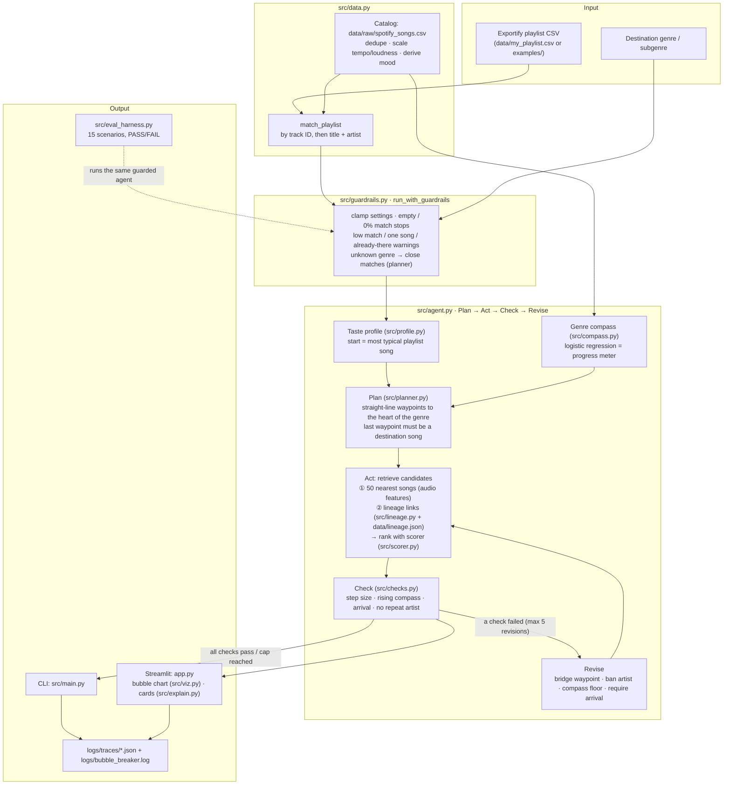

# 🫧 Bubble Breaker

**Bubble Breaker builds a gradual listening route from your playlist to a genre you don't usually listen to.** Each song is only a small step from the one before, so the new genre never feels jarring. An agent plans the route, checks its own work for jarring jumps, backtracking and repeated artists, and repairs what fails.

```
Rocket Man (Elton John) → 85% (Loote) → Never Be Alone (TheFatRat) → Storm (Drist) [bridge] → GfC (Albert Hammond, Jr.) → Damascus (LMNTRX, big room)
```

---

## Original project (Module 3)

> **TODO before submitting:** replace this line with the link to your Module 3 repository.

My Module 3 project was a rule-based music recommender over a **10-song catalog**. It scored each song against one fixed user profile: **genre match (+2) + mood match (+1) + energy similarity (up to +1)**, and returned the **top 5 songs with reasons**.

What it couldn't do:
- It only ranked songs for a fixed, hand-written profile.
- It couldn't take a real playlist as input.
- It couldn't *move* a listener toward something new.
- My own model card found that its weights favoured genre over mood.

## Goals and what's new

| | Module 3 | Bubble Breaker |
|---|---|---|
| Input | a hand-written profile | your real Spotify playlist (Exportify CSV) |
| Catalog | 10 songs | 28,352 songs ([TidyTuesday "Spotify Songs"](https://github.com/rfordatascience/tidytuesday/tree/main/data/2020/2020-01-21)) |
| Output | top-5 list | a route of songs from your taste to a destination genre |
| AI feature | — | a **Plan → Act → Check → Revise agent**; the Module 3 scorer is its *Act* step |
| Retrieval | — | **two sources**: audio-feature neighbours + a verified **song-lineage** file (RAG stretch) |
| Reliability | — | input guardrails, self-checks, revision cap, a 15-scenario evaluation harness |
| Interfaces | script | CLI (`src/main.py`) and Streamlit app (`app.py`) calling the same agent |
| Logging | — | `logging` to `logs/bubble_breaker.log`, a JSON trace of every run in `logs/traces/` |

### How the agent works

1. **Taste profile.** Your playlist songs are matched to the catalog, by Spotify track ID first, then title + artist. The route starts at your most typical song: the one closest to your playlist's average audio features.
2. **Plan.** It draws a straight line in audio-feature space from that song to the heart of the destination genre, split into *N* waypoints. The last waypoint must be a song from the destination.
3. **Act.** At each waypoint it retrieves candidates from two sources:
   - the 50 songs nearest the waypoint
   - songs linked by a real sample to the previous song or to a song in your playlist ([`data/lineage.json`](data/lineage.json))

   Your Module 3 scorer, generalised, then picks the best:
   ```
   score = 2.0 × genre_fit + 1.0 × mood_fit + feature_closeness (+ 1.0 lineage bonus)
   ```
   - `genre_fit` compares the song with the waypoint on the **genre compass**, a logistic-regression classifier giving the 0–1 probability that a song sounds like the destination.
   - `mood` is derived from valence and energy (happy, calm, angry or sad).
4. **Check.** Four tests:
   - every jump is at most `0.12`, or at most `0.30` along a sample link
   - the compass keeps rising
   - the last song really belongs to the destination
   - no artist appears twice
5. **Revise.** Each failure gets a matching fix:

   | Failure | Fix |
   |---|---|
   | Jump too big | insert a bridge waypoint halfway |
   | Repeated artist | ban that artist and pick again |
   | Compass dropped | require a higher compass reading |
   | Didn't arrive | require a destination song |

   Then it acts again, up to 5 revisions. If the cap is reached, it returns the best attempt with a warning.

### Architecture

The diagram source is also in [`assets/architecture.mmd`](assets/architecture.mmd).



---

## Setup

You need **Python 3.11** and git. The commands are for Windows PowerShell; on macOS or Linux, use `python3.11 -m venv .venv` and `source .venv/bin/activate`.

1. **Clone the repository**
   ```powershell
   git clone <this-repo-url>
   cd codepaths-applied-ai-project
   ```
2. **Create and activate a virtual environment**
   ```powershell
   py -3.11 -m venv .venv
   .venv\Scripts\Activate.ps1
   ```
   If PowerShell blocks the script, run `Set-ExecutionPolicy -Scope CurrentUser RemoteSigned` once.
3. **Install the pinned dependencies**
   ```powershell
   pip install -r requirements.txt
   ```
4. **Get the dataset.** It's not committed. The script downloads it and verifies its SHA-256 checksum:
   ```powershell
   python data/download.py
   ```
   This saves `data/raw/spotify_songs.csv`: the "30000 Spotify Songs" dataset from [TidyTuesday 2020-01-21](https://github.com/rfordatascience/tidytuesday/tree/main/data/2020/2020-01-21), collected from the Spotify API with `spotifyr`. The TidyTuesday repository is licensed **CC0 1.0**.
5. **(Optional) Add your own playlist.** Export it with [Exportify](https://exportify.app/) and save it as `data/my_playlist.csv`. It's gitignored. Without it, use the example playlists in `examples/`.
6. **Run the CLI**
   ```powershell
   python -m src.main --playlist examples/classic_rock.csv --to "big room"
   ```
7. **Run the app**
   ```powershell
   streamlit run app.py
   ```
8. **Run the tests**: 80 tests, covering both the synthetic data and the real catalog.
   ```powershell
   python -m pytest
   ```
9. **Run the evaluation harness**: 15 scenarios, printing PASS/FAIL and an overall score.
   ```powershell
   python -m src.eval_harness            # or --markdown for a table
   ```

### CLI options

```
python -m src.main --to DESTINATION [--playlist CSV] [--steps N] [--max-step X] [--no-lineage] [--no-save]
```

- `--to` takes any of the 6 genres (`edm, latin, pop, r&b, rap, rock`) or 24 subgenres (e.g. `"hard rock"`, `"big room"`, `reggaeton`).
- `--steps` is the number of planned steps (1–12, default 4).
- `--max-step` is the largest allowed jump between songs (0.03–0.5, default 0.12).
- `--no-lineage` uses audio features only.
- `--no-save` skips writing the trace file.

### Example playlists

All of these are in Exportify format and use only catalog songs:

| File | Contents |
|---|---|
| `examples/neo_soul.csv` | 15 popular neo soul songs |
| `examples/classic_rock.csv` | 15 popular classic rock songs |
| `examples/sampled_classics.csv` | 14 songs that later rap and pop songs sampled (for the lineage demo) |

---

## Sample runs (reproducible execution evidence)

All of the outputs below are real. Blocks marked *trimmed* leave out header lines but change nothing else. Nothing in the pipeline is random, so the same command gives the same output. The JSON traces for these runs are committed in [`logs/traces/`](logs/traces/).

### 1. End-to-end: neo soul → hard rock (the plan passes on the first try)

```text
$ python -m src.main --playlist examples/neo_soul.csv --to "hard rock"
Playlist: neo_soul.csv — 15/15 songs found in the catalog (100%)
Taste:    r&b 15  |  moods: sad 7, happy 4, calm 2, angry 2
From:     Put Your Records On — Corinne Bailey Rae  (compass 0.10)
To:       hard rock (subgenre)

Plan -> Act -> Check -> Revise
  Round 0: 4 steps, failed checks: none

Route (all checks passed, 0 revisions):
   0. [start  ] Put Your Records On — Corinne Bailey Rae
      neo soul, happy, compass 0.10, jump 0.000
   1. [planned] Nights Like This — After 7
      new jack swing, happy, compass 0.23, jump 0.055
   2. [planned] Purple Eyes (feat. Phoebe Ryan) — The Knocks
      indie poptimism, happy, compass 0.44, jump 0.092
   3. [planned] Summer Air - DubVision Remix — Hardwell
      progressive electro house, angry, compass 0.68, jump 0.085
   4. [planned] Erase The Pain — Palisades
      hard rock, angry, compass 0.83, jump 0.065

Full trace saved to logs\traces\20261118-030056_neo-soul_to_hard-rock.json
```

The compass (how much a song sounds like hard rock) rises 0.10 → 0.23 → 0.44 → 0.68 → 0.83, every jump is below 0.12, and the route ends on a real hard rock song.

### 2. Agent behaviour: Check fails and Revise changes the route (classic rock → big room)

```text
$ python -m src.main --playlist examples/classic_rock.csv --to "big room"
Playlist: classic_rock.csv — 15/15 songs found in the catalog (100%)
Taste:    rock 15  |  moods: happy 7, angry 5, sad 2, calm 1
From:     Rocket Man (I Think It's Going To Be A Long, Long Time) — Elton John  (compass 0.09)
To:       big room (subgenre)

Plan -> Act -> Check -> Revise
  Round 0: 4 steps, failed checks: step_too_big at step 3
      fix: step 3: too big, insert a bridge halfway from step 2
  Round 1: 5 steps, failed checks: none

Route (all checks passed, 1 revision):
   0. [start  ] Rocket Man (I Think It's Going To Be A Long, Long Time) — Elton John
      classic rock, angry, compass 0.09, jump 0.000
   1. [planned] 85% — Loote
      indie poptimism, angry, compass 0.20, jump 0.066
   2. [planned] Never Be Alone — TheFatRat
      electropop, angry, compass 0.43, jump 0.090
   3. [bridge ] Storm — Drist
      pop edm, angry, compass 0.55, jump 0.072
   4. [planned] GfC — Albert Hammond, Jr.
      permanent wave, angry, compass 0.65, jump 0.107
   5. [planned] Damascus — LMNTRX
      big room, angry, compass 0.83, jump 0.097

Full trace saved to logs\traces\20261118-030102_classic-rock_to_big-room.json
```

In round 0, the jump into step 3 was too big. Revise inserted a bridge waypoint, and the bridge song **"Storm" by Drist** exists in the final route only because the Check step caught that jump. The trace file records both rounds: the waypoints, the picks, the failed checks and the fix.

### 3. RAG enhancement: the same input with lineage off, then on

`data/lineage.json` holds **19 verified sample relationships**. Both songs in each pair are in the catalog, and every pair was checked against Wikipedia: each edge stores the article URL and a quote. The playlist `examples/sampled_classics.csv` contains songs that were later sampled.

**Without lineage (audio features only), trimmed to the route:**
```text
$ python -m src.main --playlist examples/sampled_classics.csv --to rap --no-lineage
From:     Under Pressure - Remastered — Queen  (compass 0.26)
To:       rap (genre)
Route (all checks passed, 0 revisions):
   0. [start  ] Under Pressure - Remastered — Queen
   1. [planned] Cosita Dulce — Cecy Leos
   2. [planned] Melody — Little Venice
   3. [planned] Shoulder — Hitimpulse
   4. [planned] Hot (feat. Gunna) — Young Thug
```

**With lineage (default), trimmed to the route:**
```text
$ python -m src.main --playlist examples/sampled_classics.csv --to rap
Route (all checks passed, 0 revisions):
   0. [start  ] Under Pressure - Remastered — Queen
      permanent wave, angry, compass 0.26, jump 0.000
   1. [planned] Cosita Dulce — Cecy Leos
      tropical, angry, compass 0.40, jump 0.073
   2. [planned] Changes — 2Pac
      gangster rap, angry, compass 0.57, jump 0.105
      lineage: "Changes" (2Pac) samples "The Way It Is" (Bruce Hornsby), linked to a song in your playlist
   3. [planned] King Kunta — Kendrick Lamar
      post-teen pop, angry, compass 0.65, jump 0.068
      lineage: "King Kunta" (Kendrick Lamar) interpolates "Smooth Criminal" (Michael Jackson), linked to a song in your playlist
   4. [planned] Hot (feat. Gunna) — Young Thug
      hip hop, happy, compass 0.81, jump 0.103
```

The second retrieval source replaced two anonymous stops with songs that **sample songs already in the listener's playlist**. That's a much more meaningful bridge into rap, and each pick cites its source. In the app, every lineage card links to its Wikipedia article.

### 4. Guardrails

```text
$ python -m src.main --playlist examples/neo_soul.csv --to "hard rok"
Error: Unknown destination 'hard rok'. Did you mean: hard rock?
Genres: edm, latin, pop, r&b, rap, rock
Subgenres: album rock, big room, classic rock, dance pop, electro house, electropop, gangster rap, hard rock, hip hop, hip pop, indie poptimism, latin hip hop, latin pop, neo soul, new jack swing, permanent wave, pop edm, post-teen pop, progressive electro house, reggaeton, southern hip hop, trap, tropical, urban contemporary
```

Trimmed:
```text
$ python -m src.main --playlist examples/neo_soul.csv --to rock --steps 0 --max-step 5 --no-save
...
Route (all checks passed, 0 revisions):
   0. [start  ] Put Your Records On — Corinne Bailey Rae
   1. [planned] Now I'm Here - Remastered 2011 — Queen

Warning: Steps must be 1-12; using 1 instead of 0.

Warning: Max step must be 0.03-0.5; using 0.5 instead of 5.0.
```

### 5. Reliability: evaluation harness (15/15)

`python -m src.eval_harness --markdown` produces this table, unedited:

| Scenario | Expected | Result | What happened |
|---|---|---|---|
| Demo: neo soul -> hard rock | route arrives in hard rock, all checks pass | ✅ PASS | 4 steps, 0 revision(s), 0 bridge(s), checks passed, ends on Erase The Pain — Palisades (hard rock) |
| Demo: classic rock -> big room | step too big in round 0 -> Revise inserts a bridge song | ✅ PASS | 5 steps, 1 revision(s), 1 bridge(s), checks passed, ends on Damascus — LMNTRX (big room) |
| Demo: classic rock -> reggaeton | long trip across genres arrives, all checks pass | ✅ PASS | 4 steps, 0 revision(s), 0 bridge(s), checks passed, ends on Una Vaina Loca — Fuego (reggaeton) |
| Typo in destination | stop and suggest 'hard rock' | ✅ PASS | stopped: Unknown destination 'hard rok'. Did you mean: hard rock? |
| Genre not in dataset | stop and list the valid genres | ✅ PASS | stopped: Unknown destination 'jazz'. |
| Empty playlist | stop: playlist is empty | ✅ PASS | stopped: The playlist is empty. Export a playlist with at least one song. |
| No songs in catalog (0% match) | stop: 0% match, explain catalog coverage | ✅ PASS | stopped: None of the playlist's 5 songs are in the catalog (0% match), so there's no taste to start from. The catalog has ~28k mainstream songs released up to early 2020. |
| Low match rate (4 of 10) | warn about 40% match, still build a route | ✅ PASS | warning: Only 4 of 10 songs (40%) are in the catalog; your taste profile is based on just those. / 4 steps, 0 revision(s), 0 bridge(s), checks passed, ends on Erase The Pain — Palisades (hard rock) |
| One-song playlist | warn that the profile is one song, still build a route | ✅ PASS | warning: Only one song matched, so the route starts from that single song. / 4 steps, 0 revision(s), 0 bridge(s), checks passed, ends on Erase The Pain — Palisades (hard rock) |
| Destination = current taste | warn the route stays close to home, still arrive | ✅ PASS | warning: 100% of your matched songs are already neo soul; the route will stay close to home. / 4 steps, 0 revision(s), 0 bridge(s), checks passed, ends on thank u, next — Adam Neely (neo soul) |
| Whole playlist is one artist | no artist repeats anywhere on the route | ✅ PASS | artists on route: 5/5 unique / 4 steps, 0 revision(s), 0 bridge(s), checks passed, ends on Dados — Dudu (trap) |
| Out-of-range settings (steps=0, max_step=5) | clamp to steps=1, max_step=0.5 with warnings, still build a route | ✅ PASS | warning: Steps must be 1-12; using 1 instead of 0. / 1 steps, 0 revision(s), 0 bridge(s), checks passed, ends on Now I'm Here - Remastered 2011 — Queen (album rock) |
| Impossible step limit (max_step=0.03) | hit the revision cap, return best route with a warning | ✅ PASS | warning: Hit the revision cap (5); returning the path with the fewest failed checks (4). / 4 steps, 5 revision(s), 0 bridge(s), checks failed, ends on Damascus — LMNTRX (big room) |
| Lineage on vs off (sampled classics -> rap) | lineage source changes the route via real sample links | ✅ PASS | route changed: True; lineage picks: "Changes" (2Pac) samples "The Way It Is" (Bruce Hornsby); "King Kunta" (Kendrick Lamar) interpolates "Smooth Criminal" (Michael Jackson) |
| Same input twice | identical route both times | ✅ PASS | two runs, identical route |

**Score: 15/15 scenarios passed (100%).** `pytest` runs 80 tests on top of this.

**Self-checking across all destinations.** With my own playlist and the default 4 steps, all 30 destinations produce a route that passes every check. 9 of them needed at least one revision.

---

## Limitations

- **Small, dated catalog.** It has ~28k songs in 6 mainstream genres, released up to early 2020, with no jazz, metal, lofi, indie or soundtracks. Only 6 of the 19 songs in my own playlist are in it (32%), and a Disney playlist matches 0%.
- **Genres are audio statistics.** The compass only hears 9 audio features. A song can *sound* like rap while Spotify files it under EDM: "Yl — Aivarask" appeared on one of my rap routes. Spotify's genre labels come from playlists and are noisy.
- **Mood labels are rough.** Four quadrants of valence and energy. A low-valence, high-energy song isn't always "angry".
- **The lineage file is small and hand-picked.** 19 verified links, all famous, mostly English-language hits. It mainly helps playlists that contain sampled classics.
- **The 2-D map is approximate.** The chart squeezes 9 features into 2 (PCA explains ~46% of the variance). Jumps are measured in all 9 features.
- **Straight-line planning.** Straight lines can cross sparse regions. The `hip hop` subgenre sometimes can't be smoothed, and the agent says so with a revision-cap warning.
- **Popularity bias** in which songs the dataset includes. There is also no explicit-content filter, because the dataset has no `explicit` column.

## Future improvements

- **Build the taste profile from the playlist's own audio features.** My Exportify export includes them, so any playlist would work even when its songs aren't in the catalog.
- **Let the listener choose the starting song.** Right now it's always the most typical one; for my playlist, always "Redbone".
- **Use a larger, newer catalog**, such as the 114k-track Kaggle "Spotify Tracks Dataset", so indie, lofi and jazz routes become possible.
- **Plan on a song-similarity graph** instead of straight lines, with lineage links as edges.
- **LLM explanations** (stretch goal 4). Turn the template "why this song" text into a short music-guide note grounded only in the retrieved facts, keeping the template as the fallback.

---

## Reflection on AI collaboration

I built this with an AI assistant (Claude) and kept a running log in [`ai_interactions.md`](ai_interactions.md).

**How I used AI**
- **Design.** I turned a project idea into a phased build plan, and used the AI to generalise my Module 3 scorer into the agent's Act step.
- **Code.** It wrote each module and its tests: data, scorer, compass, planner, checks, agent, CLI, app.
- **Debugging.** It ran experiments instead of guessing. One measured the agent on all 30 destinations to choose `MAX_STEP`. Another rendered the chart to an image, which revealed the route was hidden under the background dots.
- **Explaining.** When an output surprised me, I asked "is this expected?" and "how does this work?". A 32% match rate and every route starting at the same song are two examples.

**Accepted**
- **Mood from valence and energy.** The dataset has no mood column, so this keeps the original "+1 for mood" idea.
- **Making arrival part of the plan.** I questioned why the first attempt failed the arrival check on 26 of 30 routes. The AI agreed it was a design flaw: the destination is known up front, so it belongs in the Plan. After the change, every revision fixes a real problem.

**Rejected**
- **Switching to the 114k-track dataset.** The AI recommended it after my low match rate. I kept the 30k dataset to stay in scope, and accepted fewer genres.
- **Building the profile from my CSV's audio features.** This would make my Disney playlist work, but it's a larger refactor. I listed it as a future improvement instead.

**Revised**
- **Graph search → straight-line waypoints.** Simpler, and Check/Revise gets real work to do.
- **The plan's RAG demo.** "Steely Dan → *Champion*" isn't possible with this dataset, so it became `sampled_classics → rap`, using 19 Wikipedia-verified links.

**What I learned.** AI output needs checking, and the most useful checks were concrete:
- running the system on real data (it exposed the scorer jumping to far-away songs)
- looking at the rendered chart (the route was buried)
- reading the actual CLI output while writing this README (it printed `lineage: nan`)

Each of those was a bug the tests alone hadn't caught. Asking the AI "why?" about surprising behaviour led to better design than accepting its first answer.

---

## Project layout

```
app.py                  Streamlit UI (calls src.guardrails.run_with_guardrails)
src/
  data.py               load + clean catalog, Exportify playlist, matching
  profile.py            taste profile (start song)
  compass.py            genre classifier = progress meter
  scorer.py             Module 3 scorer, generalised (Act step)
  planner.py            destinations + straight-line waypoints (Plan)
  checks.py             self-checks (Check)
  agent.py              Plan → Act → Check → Revise loop + trace
  lineage.py            second retrieval source (RAG)
  guardrails.py         input validation; single entry point for CLI / app / harness
  explain.py            "why this song" text
  viz.py                bubble chart (PCA map)
  main.py               CLI
  eval_harness.py       15 reliability scenarios
data/download.py        dataset download + checksum
data/lineage.json       19 verified sample links with sources
examples/               demo playlists (Exportify format)
logs/traces/            JSON traces of sample runs
assets/architecture.mmd architecture diagram
tests/                  80 pytest tests
ai_interactions.md      AI collaboration log
```
